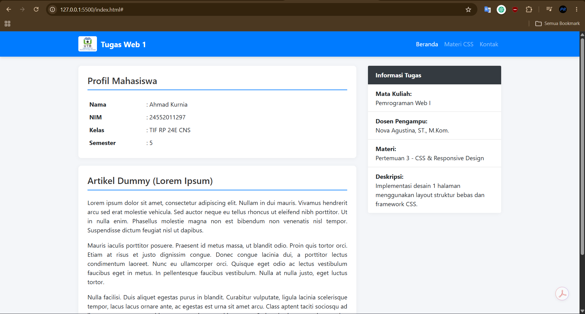

# Tugas Pertemuan 3 - CSS & Responsive Design

**Identitas Mahasiswa:**
- **Nama:** Ahmad Kurnia
- **NIM:** 24552011297
- **Mata Kuliah:** Pemrograman Web I 
- **Kelas:** TIF RP 24E CNS
- **Semester:** 5
- **Dosen Pengampu:** Nova Agustina, ST., M.Kom.

## Deskripsi Tugas
Membuat desain 1 halaman sederhana dengan mengimplementasikan layout berstruktur bebas, terdiri dari Heading Menu (menggunakan navbar) dan isi konten berbasis framework CSS (Bootstrap 4).

## Hasil Tampilan Web (Live Server)

